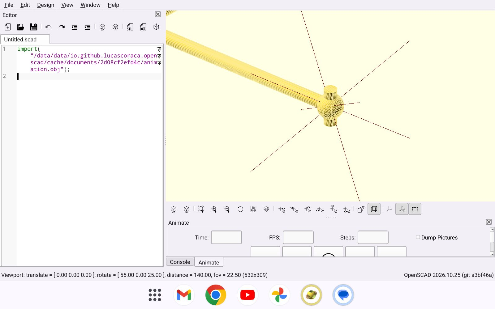

<p align="center">
  
</p>

<h1 align="center">OpenSCAD for Android</h1>

<p align="center">
  The OpenSCAD desktop app (same language, same geometry engine, same interface) running natively on Android phones and tablets.
</p>

<p align="center">
  <a href="https://github.com/LucasCoraca/openscad-android/releases/latest"><b>Download APK</b></a> ·
  <a href="#building-from-source"><b>Build from source</b></a>
</p>

<p align="center">
  
</p>

> **Unofficial community port, preview quality.** This project is not affiliated with or endorsed by the OpenSCAD team.
> Upstream OpenSCAD lives at [openscad/openscad](https://github.com/openscad/openscad).

## What this is

This is OpenSCAD itself, compiled for Android against Qt 6.8, plus a set of Android patches:

- **Same app.** The editor (QScintilla), customizer, console, animation, the CGAL and Manifold renderers and OpenCSG preview all come from upstream OpenSCAD.
- **OpenGL ES.** The 3D view runs on GLES through [gl4es](https://github.com/ptitSeb/gl4es), with shader fixes for GLSL ES.
- **Made for touch.** You drag to rotate, use two fingers to pan and pinch to zoom, and double tap to centre the view on a point. A long press on the model opens its object menu, which jumps to the source line. The editor, lists and menus scroll with your finger.
- **Phones and tablets.** Tablets get the desktop layout. On a narrow portrait screen the editor moves above the 3D view. Dialogs are sized to fit the screen, and the window keeps its layout when the keyboard opens.
- **Android integration.** Open, Save and Export go through the system file picker, so Google Drive and other providers work. Back sends the app to the background instead of quitting.
- **Export** to STL, 3MF, OBJ, DXF, SVG, PDF and PNG.

## Install

1. Download `OpenSCAD-android-arm64-preview.apk` from the [latest release](https://github.com/LucasCoraca/openscad-android/releases/latest). It works on almost every phone and tablet made since 2017. The `x86_64` APK is for emulators and Chromebooks.
2. Allow installing apps from your browser or file manager when Android asks.

You need Android 9 (API 28) or newer and OpenGL ES 3.0.

## Status

Tested by tapping through the whole UI on a tablet emulator and a phone-sized emulator (see [docs/TESTING.md](docs/TESTING.md)). The arm64 build has not yet been tested on real hardware.

## Building from source

Requirements: Linux x86_64, the Android SDK with NDK 29.0.14206865, build-tools 34.0.0 and platform android-34, JDK 17, and Qt 6.8.3 for Android (qtbase per ABI plus a host Qt). Paths are set in `env.sh` and can be overridden from the environment.

```sh
./fetch-sources.sh                 # OpenSCAD (pinned and patched), dependencies, host tools
./build-hosttools.sh               # m4, bison, flex, gperf, cmake/ninja/meson venv, signing key
./build-deps.sh arm64-v8a          # every dependency, static, into deps-android/
./configure-app.sh arm64-v8a
./build-app.sh arm64-v8a           # signed APK in dist/
```

Use `x86_64` instead of `arm64-v8a` for the emulator build. The Android patches are in `patches/`, and the Android-only app code is in `android/app/main.cc`.

## License

GPL-2.0-or-later, like OpenSCAD. See [LICENSE](LICENSE).
